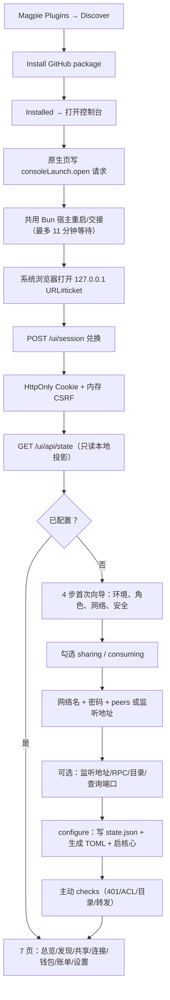
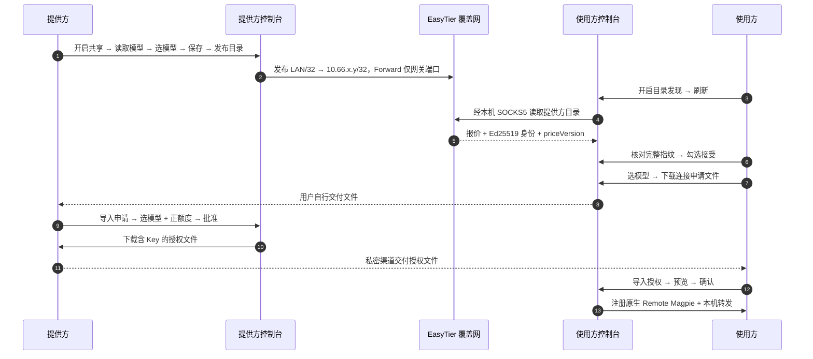
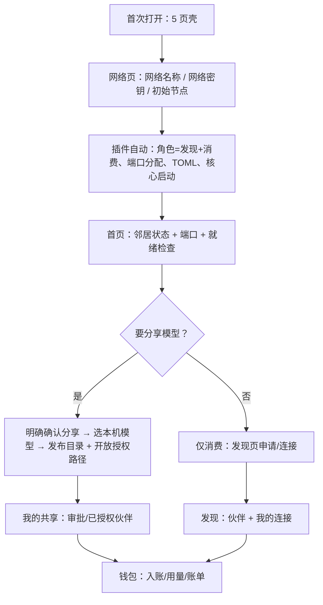
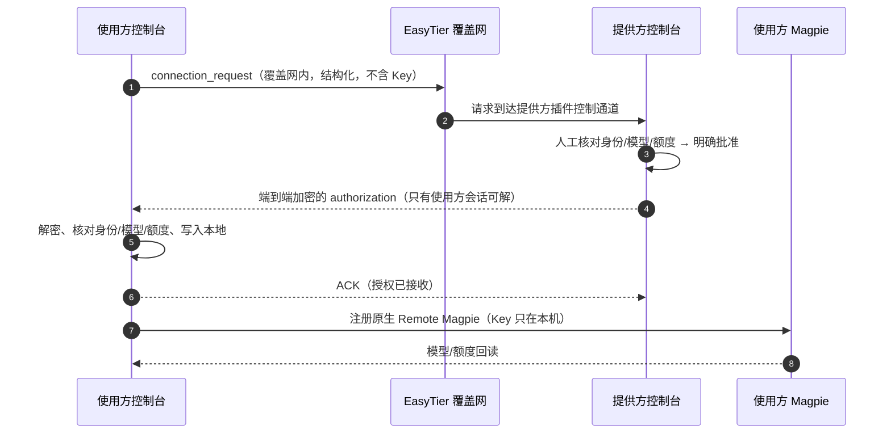
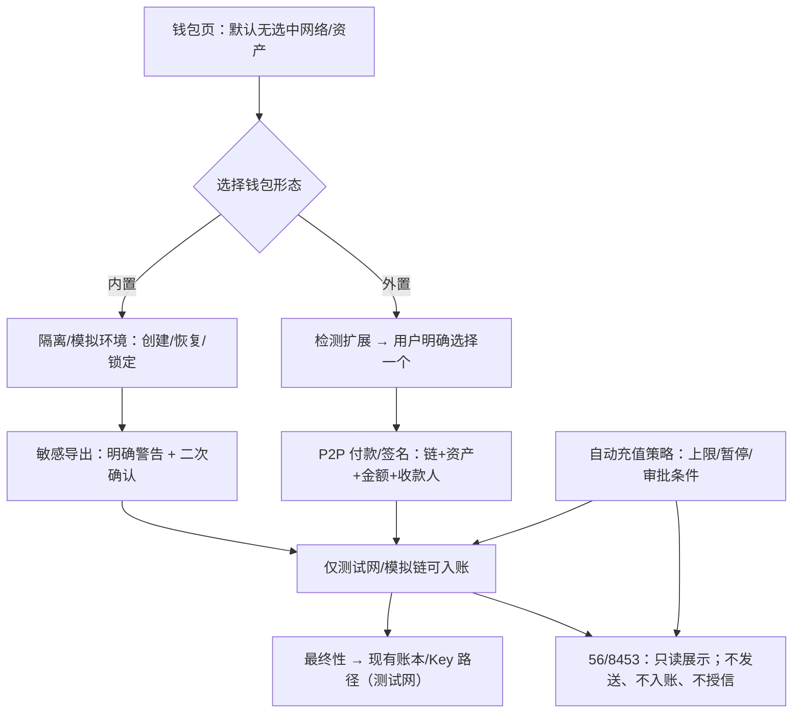
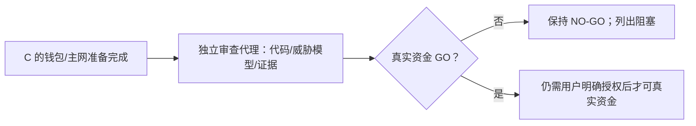
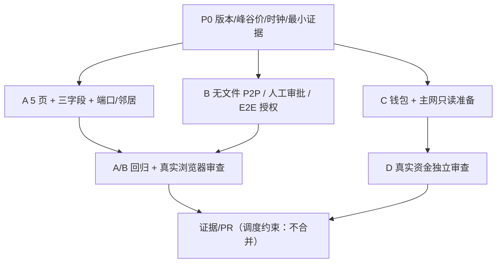

# Phase 10 — 前后流程、边界与验收矩阵（FLOWS）

> 配套：[INVENTORY.md](INVENTORY.md)、[STATUS.md](STATUS.md)。
> **字母严格按用户定义**：
> **A = 视觉/交互/三字段/端口/状态邻居**；
> **B = 无文件 P2P / 人工审批 / 端到端加密授权**；
> **C = 钱包与主网准备**；
> **D = 真实资金独立审查**。
> 版本复测、测试时钟、峰谷价 fail-closed 是 **P0 基础单元**，不属于 D，也不单独改字母。
> 签名文件、邀请卡只允许作为 B 的**紧急兼容回退**，不能作为目标或替代 B。
> “不合并 PR”是调度约束，不是用户对产品的明文要求。

## 0. 图例

| 标记 | 含义 |
| --- | --- |
| 实线框 | 现有代码/现有步骤 |
| 虚线框 | Phase 10 目标新增/改造（PROPOSED） |
| 菱形 | 人工明确决定（不可自动化） |
| 红色语义 | 安全门/失败关闭，不是“稍后重试” |
| P0 | 版本 0.1.2289 + EasyTier 2.6.4、峰谷价 fail-closed、测试时钟、最小证据 |

## 1. 现状：安装、打开、配置

**现状问题**：首次要选角色、填可选端口；7 页把“连接”和“账单”拆开；邻居/端口不在一处；文件往返（申请/授权）成为跨人主路径。

## 2. 现状：共享 → 发现 → 申请 → 批准 → 授权 → 连接（文件路径）

**这是 B 要替换的目标路径**：文件只是当前实现与紧急回退，不是 Phase 10 的目标。

## 3. A — 视觉/交互/三字段/端口/状态邻居（PROPOSED）

### 3.1 目标信息架构：**5 页**

| 页 | 内容 | 合并自现状 |
| --- | --- | --- |
| 首页 | 网络状态、引擎/就绪、**邻居状态**、**端口**、最近证据、快捷入口 | 总览 + 部分连接状态 |
| 发现 | 伙伴目录、模型/价格、显式信任、申请、**我的连接（Remote Magpie）** | 发现 + 我的连接 |
| 我的共享 | 共享开关、模型选择、目录发布、申请审批、已授权伙伴 | 我的共享 |
| 钱包 | 钱包/入账/证据时间线、**用量与账单**、异常审计 | 测试网钱包 + 用量与账单 |
| 网络 | **首次仅三字段**、端口/高级项、能力说明 | 网络与设置 |

不保留独立的“我的连接”“用量与账单”“网络与设置”三个旧导航；内容并入上表。

### 3.2 首次配置只问三个字段

- **网络名称**
- **网络密钥**
- **初始节点**（可选：若为空则插件生成/接受监听；不再要求用户先理解“接受连接/监听地址”）

角色、端口、目录端口、查询端口、RPC 端口由插件自动分配/持久化；高级项折叠在“网络 → 高级”，默认不出现。
**所有节点天然发现 + 消费**；只有当用户明确确认“分享我的模型”时，才发布模型并开放授权路径。
“分享”不是角色开关的同义词：不分享也可以发现/消费；分享必须单独确认。

### 3.3 目标流程

### 3.4 A 的不变式

- 不自动分享；不自动信任；不自动批准；不自动发 Key。
- 三字段之外不要求普通用户填写端口/角色；但高级项仍可展开。
- 首页的“邻居”是路由提示，不是身份；不得把邻居/端口显示成“已授权”。
- 保留价格未锁定、真实资产未开放、未知≠0 等提示；可折叠但默认可见结论。
- 5 页不减少安全确认次数；只减少导航与配置负担。

## 4. B — 无文件 P2P / 人工审批 / 端到端加密授权（PROPOSED）

### 4.1 目标流程（替换文件往返）

- **首次/身份变化仍人工 TOFU**：使用方必须核对完整指纹并显式接受；提供方批准时再次核对当前报价/身份。
- **没有文件**：`connection_request` 和 `authorization` 都是覆盖网内的结构化消息；不生成下载/上传文件。
- **E2E 加密**：授权只对使用方本次会话的临时公钥加密；提供方也不能把 Key 写给第三方；重放/过期/ACK 缺失都必须拒绝。
- **人工审批**：提供方选择模型 + 填正额度 + 明确勾选；无自动批准、无自动发 Key。
- **ACK 后才注册**：未收到 ACK 不认为交付完成；未知结果不自动重试、不重复发 Key。
- **控制通道边界**：它是插件控制面，不是 Magpie 管理面、不是 AI 网关、不是第二计费点；只开放在覆盖网内，端口只在分享/授权路径开启时发布，Inbound 仍 Drop。
- **紧急兼容**：现有申请/授权文件保留，但只在控制通道不可用时由用户显式选择；不得作为默认或验收替代。

### 4.2 加密与身份（设计约束，待安全评审）

| 项 | 约束 |
| --- | --- |
| 传输 | EasyTier 覆盖网内；不新增中心服务器/DHT/mDNS |
| 会话密钥 | 每请求临时密钥对（X25519 或 P-256 ECDH）+ HKDF + AEAD（AES-256-GCM） |
| 身份 | 绑定目录 Ed25519 公钥/指纹 + 人工 TOFU；不是“连上即信任” |
| 审批绑定 | 批准绑定 request hash、提供方身份、报价 hash、模型集合、正额度、过期时间 |
| 授权加密 | 只加密给使用方临时公钥；提供方控制台不长期保存明文 Key |
| 重放 | 一次性 nonce + 过期 + ACK 墓碑；已消费不可复活 |
| 失败 | 解密/身份/报价/额度任一不匹配 → 拒绝；未知结果不自动重试 |

### 4.3 实现落点（预计）

| 变更 | 文件 | 说明 |
| --- | --- | --- |
| 控制通道服务 | 新增 `plugin/src/control-channel.ts`（名称待定） | 只绑定 LAN/覆盖网可达地址；ACL 只允许控制端口 |
| 加密/身份 | 新增 `plugin/src/secure-channel.ts` | ECDH + AEAD + 签名 transcript；复用目录身份/TOFU |
| 请求/授权 schema | `connection-request.ts` 扩展或新增 v2 | 仍是结构化、限长、字段白名单 |
| 审批/ACK | `console-workflows.ts` / `service.ts` | 人工批准、一次性交付、ACK 墓碑 |
| UI | 发现/我的共享 | 无文件；状态机显示 pending/approved/delivered/connected |
| 测试 | 新增协议负向测试 | 篡改/重放/过期/错身份/错报价/无 ACK |

## 5. C — 钱包与主网准备（PROPOSED）

### 5.1 目标能力

- **56/8453 只读网络平权**：与测试网同形展示、同一注册表、无 primary；但**只读**，不扫描、不入账、不发交易。
- **用户收款网络默认空选**：不自动选择链/资产；必须明确选择。
- **严格资产**：`(chainId, contract)` 唯一身份、链上 decimals 校验、白名单；拒绝任意代币/符号推断。
- **隔离模拟钱包**：创建/恢复/锁定/敏感导出在隔离/模拟环境完成；**不声称生产级安全**，不接真实资金。
- **多扩展明确选择**：检测到多个浏览器钱包扩展时必须由用户明确选择；不自动挑、不自动切链。
- **P2P 付款/签名**：使用方外部钱包签名 + 提供方验证；签名文件/转账指引仍可用，但不再作为 B 的授权通道。
- **自动充值策略**：策略/计划/上限/暂停条件可配置；**主网发送/授信硬禁止**；真实资金 NO-GO。
- **内置钱包**：开发创建/恢复/锁定/敏感导出能力；明确标注“非生产级安全”，默认不承载真实资产。

### 5.2 目标流程

### 5.3 C 的红线

1. **主网 56/8453**：只读网络平权；不广播交易、不扫描入账、不抬 Key cap、不自动充值。
2. **真实资金 NO-GO**：内置钱包不声称生产级安全；敏感导出有明确警告；默认不承载真实资产。
3. 不保存明文私钥到状态/日志/页面；内置钱包的密钥存储方案必须单独安全评审。
4. 不自动选择链/资产/扩展；收款网络默认空选。
5. 不把测试网/模拟链结果写成主网付款或主网授信。
6. 不因收到转账自动解除暂停；不自动再签发。

## 6. D — 真实资金独立审查（PROPOSED）

D 不是实现工作流，也不负责版本/时钟/峰谷价（那些是 P0）。D 只做一件事：在 C 的钱包/主网准备完成后，由**独立于实现者的审查代理**评估“是否允许真实资金”，输出 GO/NO-GO。

审查范围：内置钱包密钥存储/导出、扩展选择与签名、P2P 付款归属、自动充值策略、主网只读边界、账本/Key 回读、失败关闭、日志/快照泄漏、平台差异。D **不得**自己改代码；只出审查报告与阻塞清单。

## 7. P0 — 共同基础单元（不属于 A/B/C/D）

| 项 | 内容 | 验收 |
| --- | --- | --- |
| P0-1 | 目标版本：**本机 0.1.2289 + EasyTier 2.6.4**，隔离副本，不改用户安装 | 版本/哈希/平台记录；隔离 data dir |
| P0-2 | 峰谷价：**先 fail-closed 拒绝不支持的价格**（`peak` 存在即拒绝发布/签发），后续单独实现 | 负向测试 + 证据 |
| P0-3 | 测试时钟：注入可控时钟，去掉 wall-clock 依赖 | `bun run test` 全绿 |
| P0-4 | 最小重测：401/429/limit/top-up/restart | 脱敏日志 + 可复现命令 |
| P0-5 | 证据/CI | 双平台 CI + 文档 pin |

**版本已决定，不再要求用户选择**：本轮目标 0.1.2289。0.1.2038/0.1.2171 只作为历史证据引用，不混用结论。

## 8. A/B/C/D 边界与依赖

| 工作流 | 范围内 | 范围外 | 依赖 | 主要文件 | 失败关闭点 |
| --- | --- | --- | --- | --- | --- |
| **A 视觉/交互** | 5 页 IA、三字段首次、端口、邻居/状态、贴纸视觉、空/错态、可访问性 | 新 P2P 协议、钱包能力、自动信任/审批 | P0 | `console/index.html`、`console/*.js`、`console/style.css`、`page/style.css` | 测试断言/动作白名单/敏感响应回归 → 回滚 |
| **B 无文件 P2P** | 覆盖网 control channel、connection_request、人工审批、E2E 授权、ACK、原生 Remote 注册 | 文件作为目标、自动信任/批准、中心中转、AI 代理 | P0、目录/TOFU、Provider 注册 | 新增控制通道/加密模块、`console-workflows.ts`、`service.ts`、`console/*` | 解密/身份/报价/额度/ACK 任一失败 → 拒绝 |
| **C 钱包与主网准备** | 56/8453 只读平权、默认空选、严格资产、内置/外置/多扩展、敏感导出、P2P 付款/签名、自动充值策略（隔离/测试网） | 主网发送/入账/授信、真实资金、生产级安全声明 | P0 | `networks.ts`、`wallet.ts`、`console-wallet.ts`、`wallet-workflows.ts`、`console/wallet.js` | 主网发送/授信 → 硬拒绝 |
| **D 真实资金审查** | 独立审查 C 的真实资金风险 | 实现、版本门、时钟、峰谷价 | C 完成 + P0 | 审查报告 | 未 GO → 真实资金保持禁止 |

## 9. 验收矩阵（PROPOSED）

> `现有` = 已有代码/证据；`待办` = Phase 10 实现/补证；`阻塞` = 前置未满足。
> 所有证据标 VERIFIED / REPRODUCED / UNKNOWN，并区分模拟 / 真实 Magpie+EasyTier / 主网。

### A — 视觉/交互

| ID | 场景 | 前置 | 证据 | 通过标准 | 状态 |
| --- | --- | --- | --- | --- | --- |
| A1 | 5 页 IA | P0 | 截图矩阵 | 首页/发现/我的共享/钱包/网络；无旧独立连接/账单/设置页 | 待办 |
| A2 | 首次仅三字段 | P0 | UI 步骤 + state | 只问网络名称/密钥/初始节点；角色/端口自动 | 待办 |
| A3 | 端口与邻居状态 | A2 | 首页截图 + 真实 EasyTier | 显示实际端口/邻居；不把邻居当授权 | 待办 |
| A4 | 默认发现+消费、显式分享 | A2 | 两节点 UI | 默认不分享；明确确认后才发布模型/开放授权 | 待办 |
| A5 | 贴纸视觉 + 深浅/窄屏 + 可访问性 | A1 | 截图 + axe/人工 | 对比度/焦点/ARIA/减少动效；无外部资源 | 待办 |
| A6 | 行为零回归 | A1–A5 | console/security 测试 | 动作名/幂等/敏感响应/CSP 不变 | 待办 |

### B — 无文件 P2P

| ID | 场景 | 前置 | 证据 | 通过标准 | 状态 |
| --- | --- | --- | --- | --- | --- |
| B1 | 覆盖网内 connection_request | P0 | 协议日志 + 校验 | 结构化、限长、无 Key；不落文件 | 待办 |
| B2 | 提供方人工批准 | B1 | UI + 审计 | 选模型 + 正额度 + 明确勾选；无自动批准 | 待办 |
| B3 | E2E 加密授权 | B2 | 密文 + 解密/拒绝测试 | 只有使用方临时公钥可解；提供方不持久化明文 | 待办 |
| B4 | ACK 后才注册 | B3 | 状态机 + 回读 | 无 ACK 不完成；未知不重试/不重发 | 待办 |
| B5 | 原生 Remote Magpie 注册 | B4 | 模型/额度回读 | 只注册本插件连接；模型集合一致 | 待办 |
| B6 | 首次/变化 TOFU 人工 | B1 | 负向测试 | 未接受/身份变化禁止请求/连接 | 待办 |
| B7 | 重放/篡改/过期 | B1–B5 | 负向测试 | 全部拒绝；无文件回退自动启用 | 待办 |
| B8 | 紧急文件兼容 | B7 | 显式选择 + 警告 | 仅用户显式选择；默认不使用；不作为验收替代 | 待办 |

### C — 钱包与主网准备

| ID | 场景 | 前置 | 证据 | 通过标准 | 状态 |
| --- | --- | --- | --- | --- | --- |
| C1 | 56/8453 只读平权 | P0 | 注册表/UI | 同形、无 primary；不扫描/不入账/不发送 | 待办 |
| C2 | 收款网络默认空选 | C1 | UI 状态 | 默认无链/无资产；必须明确选择 | 待办 |
| C3 | 严格资产 | C1 | 合约/decimals 证据 | `(chainId, contract)`；拒绝任意代币/符号推断 | 待办 |
| C4 | 内置钱包创建/恢复/锁定 | P0 | 隔离模拟记录 | 明确非生产级安全；无真实资产 | 待办 |
| C5 | 敏感导出 | C4 | 警告 + 二次确认 | 明确风险；不写日志/快照；可撤销/锁定 | 待办 |
| C6 | 多扩展明确选择 | P0 | 多扩展夹具 | 用户明确选择一个；不自动挑/不自动切链 | 待办 |
| C7 | P2P 付款/签名 | C3 | 测试网/模拟记录 | 归属/金额/收款人/链严格匹配；不广播主网 | 待办 |
| C8 | 自动充值策略 | C4–C7 | 策略 + 负向测试 | 上限/暂停/审批可配；主网发送/授信拒绝 | 待办 |
| C9 | 主网发送/授信硬禁止 | C1–C8 | 负向测试 | 任何主网 send/credit/cap 路径拒绝 | 待办 |
| C10 | 真实资金 | — | — | **NO-GO**（D 审查 + 用户明确授权前） | 禁止 |

### D — 真实资金独立审查

| ID | 场景 | 前置 | 证据 | 通过标准 | 状态 |
| --- | --- | --- | --- | --- | --- |
| D1 | 独立审查启动 | C 完成 | 审查计划 | 审查者独立于 C 实现 | 待办 |
| D2 | 密钥/导出/扩展/归属/策略/主网只读 | D1 | 报告 + 复现 | 逐项 PASS/FAIL/UNKNOWN；不自己改代码 | 待办 |
| D3 | 真实资金 GO/NO-GO | D2 | 签署报告 | 默认 NO-GO；GO 也需用户明确授权 | 待办 |

### P0 — 基础单元

| ID | 场景 | 证据 | 通过标准 | 状态 |
| --- | --- | --- | --- | --- |
| P0-1 | 0.1.2289 + EasyTier 2.6.4 隔离副本 | 版本/哈希/平台 | 不改用户安装；可复现启动 | 待办 |
| P0-2 | `peak` fail-closed | 负向测试 | 不支持价格 → 拒绝发布/签发，不按静态价放行 | 待办 |
| P0-3 | 测试时钟 | `bun run test` | 全绿；不依赖真实日期 | 待办 |
| P0-4 | 最小重测 | 脱敏日志 | 401/429/limit/top-up/restart | 待办 |
| P0-5 | 证据/CI | PR/run | 双平台绿 + 文档 pin | 待办 |

## 10. 失败、回滚与发布边界

| 工作流 | 失败表现 | 回滚 |
| --- | --- | --- |
| A | 布局/文案/测试断言回归 | 仅回滚 CSS/HTML/渲染，不动业务 |
| B | 解密/身份/报价/额度/ACK 失败 | 拒绝请求；不落 Key；不自动切文件；保留旧连接 |
| B | 控制通道不可用 | 用户显式选择紧急文件回退；默认不使用 |
| C | 主网发送/授信被触发 | 硬拒绝；不产生交易/账本/Key 变更 |
| C | 内置钱包/导出风险 | 锁定/清空会话；保留审计；不声称生产级 |
| D | 审查未通过 | 真实资金保持 NO-GO，列出阻塞 |

- 不合并 PR 是**调度约束**，不是用户对产品的明文要求。
- A/B 不引入数据迁移；C 新增字段必须向后兼容 `ledger.sqlite`/`chain.sqlite`/`networks.json`。
- 所有新增动作：白名单名、字段白名单、输入上限、幂等语义、负向测试、敏感输出遮盖。
- 所有新增状态：未知/失败与“零/正常”分开显示；不得用绿色表示未证实。

## 11. 仍待确认

1. **A 的“三字段”**：本文件按“网络名称、网络密钥、初始节点”记录；如用户指其他三项，只改 A 小节。
2. **B 的控制通道形态**：允许新增覆盖网内插件控制端口，还是必须复用现有目录/转发路径？这决定协议实现。
3. **C 自动充值策略的范围**：仅测试网/模拟链可执行；主网只出策略不执行。若用户要求策略也仅展示，需明确。
4. **D 的触发条件**：C 哪些单元完成才启动 D；D 的 GO 是否还需用户逐项确认。
