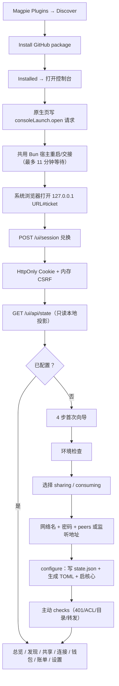
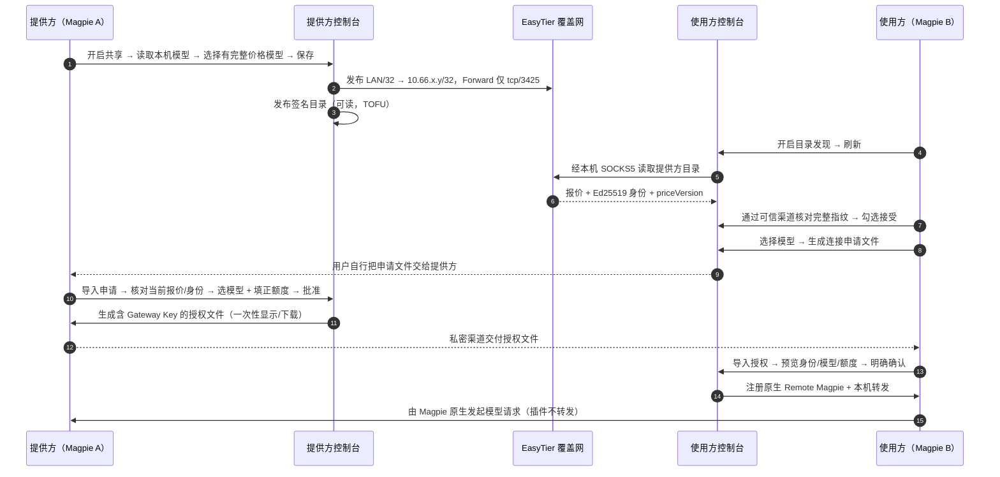
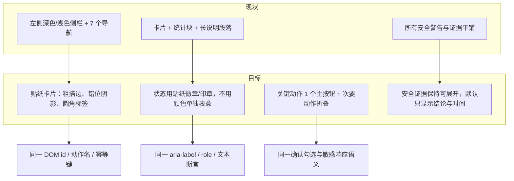
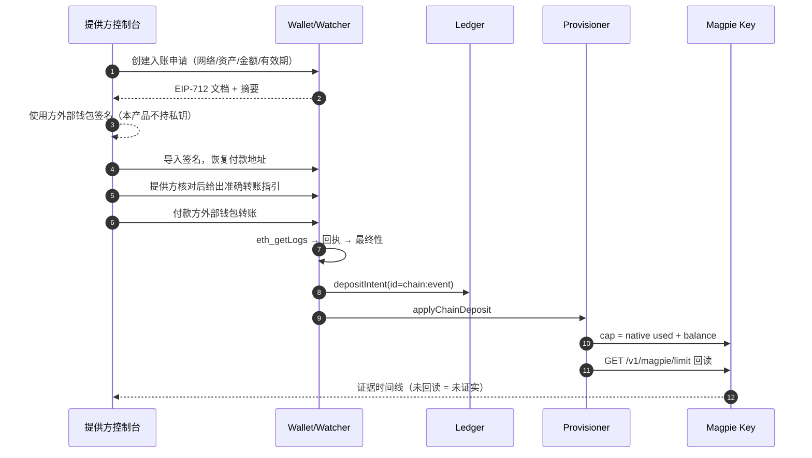
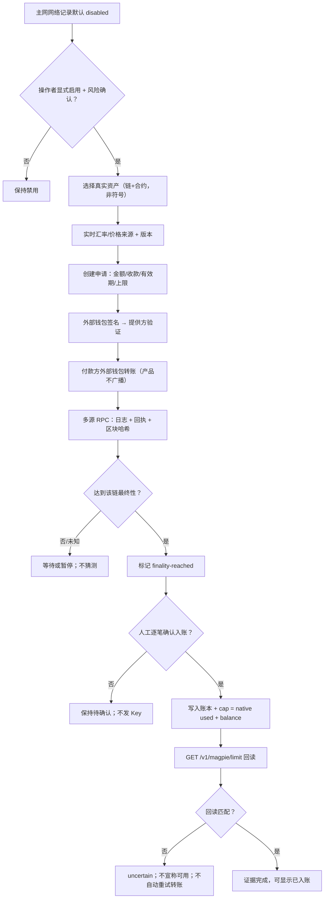
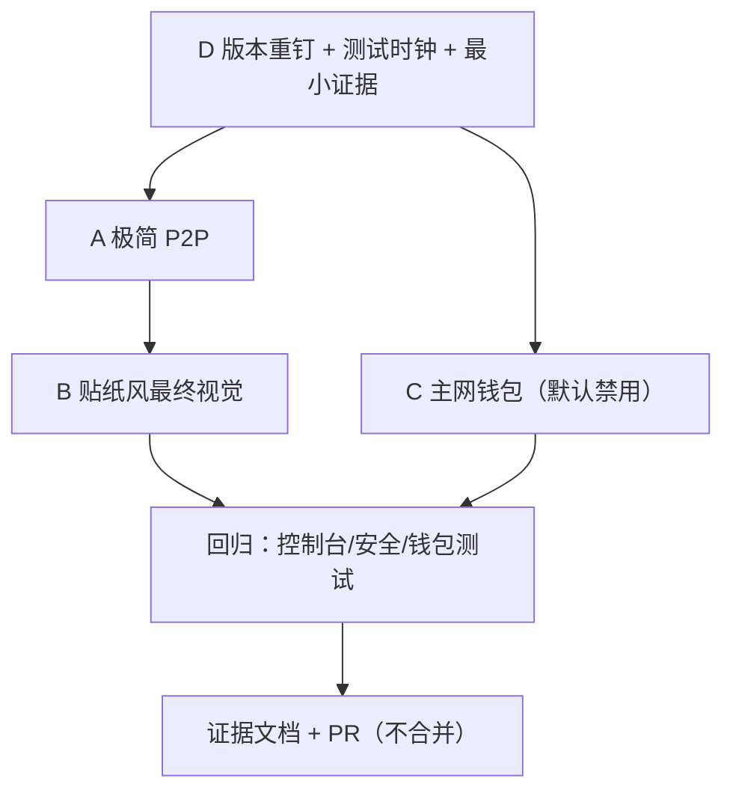

# Phase 10 — 前后流程、边界与验收矩阵（FLOWS）

> 配套文件：[INVENTORY.md](INVENTORY.md)。本文的“现状”来自 main `8ce5c57` 的代码与既有验证报告；
> “目标”是 **PROPOSED**，需主代理确认后再实现。所有 Mermaid 只表达业务/信任边界，不表示已实现。
> **硬约束**：真实资金、主网自动授信、自动充值仍然 NO-GO；不新增中心化中转、账户体系、AI 代理或第二条计费路径。

## 0. 图例

| 标记 | 含义 |
| --- | --- |
| 实线框 | 现有代码/现有步骤 |
| 虚线框 | Phase 10 新增或改造 |
| 菱形 | 人工明确决定（不可自动化） |
| 红色语义 | 安全门/失败关闭，不是“稍后重试” |
| `A/B/C/D` | A=极简 P2P，B=贴纸风重设计，C=主网钱包升级，D=版本重钉与证据门（D 为本次建议映射） |

## 1. 现状：从安装到可用

**现状的所有权/安全边界**

- 一个 Magpie 数据目录只有一个插件宿主；`host.lock.sqlite` 独占事务，候补不抢活 owner。
- 浏览器只拿到短期会话，不拿 Bearer API token；Bearer 通道留给 CLI/脚本。
- 原生页始终 `connect-src 'none'`；打开/配对批准走官方 options 桥，保存 options 会重启共用宿主。
- 控制台 48 个白名单动作之外没有任意转发；写操作有 CSRF + UUID 幂等，不自动重试。

## 2. 现状：共享 → 发现 → 申请 → 批准 → 授权 → 连接

**为什么不能省掉这些门**：TOFU 只证明“同一密钥”，不等于现实身份；申请导入本身不授权；Key 交付必须一次性显式；额度必须由提供方手动填正数；价格未锁定（`priceLocked:false`）。

## 3. A — 极简 P2P 体验（PROPOSED）

### 3.1 目标

把“两个人第一次连上”从 **约 13 个跨人步骤** 压到 **约 7 个**，但不删除任何人工安全决定：

1. 提供方一次生成 **邀请卡**（可下载/复制的 JSON 或短文本）：网络加入线索、提供方显示名、mapped 地址/网关端口、目录地址与端口、当前身份指纹、报价摘要。
2. 使用方导入邀请卡 → 一次确认加入网络 → **实时读取目录** → 指纹与卡片一致才允许接受。
3. 使用方选模型 → 一次生成申请。
4. 提供方打开申请 → 选模型 + 正额度 → 一次批准（自动准备授权文件，仍由提供方显式下载/交付）。
5. 使用方导入授权 → 一次确认 → 连接完成。

关键：**邀请卡是线索，不是信任**；实时目录与用户核对仍必须发生。邀请卡可以预填网络参数，减少“复制网络名/密码/节点地址/端口”的手工步骤。

### 3.2 目标流程

### 3.3 不变式（A 不能碰）

- 不自动接受 TOFU；不自动批准申请；不自动生成 Key；不自动充值/抬额度。
- 邀请卡不得包含 Gateway Key；默认不包含网络密码（见 §7 待确认项），若包含必须二次确认、明确标注、一次性。
- 不新增公网/中转服务；不改变 Forward/Inbound ACL；不改变目录签名与价格版本。
- 不把“连接成功”显示成“额度可用”；未知额度仍显示未知。
- 不引入本地存储的长期秘密；邀请卡是一次性文件，不是会话。

### 3.4 实现落点（预计）

| 变更 | 文件 | 说明 |
| --- | --- | --- |
| 邀请卡 schema/校验 | 新增 `plugin/src/invite.ts`（或 `connection-request.ts` 旁） | 48 KiB 上限、字段白名单、网络秘密可选、版本号 |
| 导出邀请 | `service.ts`（目录/身份/mapped/port 的既有只读投影）+ `console-api.ts` 新动作 `invite-create` | 不新增秘密来源；复用 `catalogStatus()`/`requestApprovalContext()` |
| 导入邀请 | 控制台 `providers.js` + `configure` 预填 | 加入网络仍走既有 `configure`，失败回滚已有 |
| 一键申请 | `console-workflows.ts` + `connection-request.ts` | 仍是现有文档，不新增授权语义 |
| 一键批准/交付 | `console-workflows.ts` | 复用 `approve` + `reveal`，不合并成自动动作 |
| 测试 | `console-workflows.test.ts`、`providers.test.js`、`console-security.test.ts` | 邀请卡伪造/过期/跨节点/含 Key 必须拒绝 |

## 4. B — 贴纸风重设计（PROPOSED）

### 4.1 目标

只改**视觉与信息层级**，不改业务动作、传输、安全提示与数据。现有控制台是单一 `style.css`（约 32 KB）+ 原生 DOM 渲染，无前端框架、无构建步骤、无外部字体/图片。贴纸风可以完全在本地资产内完成。

### 4.2 不变式

- 不引入远程字体、CDN、图片、CSS `@import`、内联脚本；CSP 不变。
- 不放宽 48 个动作白名单；不改 `console-server.ts`。
- 不删除“价格未锁定”“真实资产未开放”“未知不等于 0”“Key 只交付一次”等提示；可折叠但默认可见结论。
- 保留 `providers.test.js` / `wallet.test.js` / `session.test.js` / `page-settings.test.ts` 断言的可观察文本、控件数量与顺序（或先更新测试并说明理由）。
- 不把额度 0 显示成绿色；不把“已连接”显示成“已授权”。
- 深浅色、窄屏（WebKit mobile 截图基线）、键盘焦点、`prefers-reduced-motion` 必须覆盖。

### 4.3 验收要点

| 项 | 通过标准 |
| --- | --- |
| 视觉 | 7 个页面 + 弹窗 + 空状态 + 错误态统一；无布局溢出（360 px 宽） |
| 可访问性 | 对比度 ≥ 4.5:1（正文）；焦点可见；按钮有可读名称；贴纸装饰 `aria-hidden` |
| 回归 | 类型检查、控制台单元测试、安全测试全绿；动作名/幂等/敏感响应测试不变 |
| 资产 | 仓库内只有本地 SVG/CSS；无新增网络请求（DevTools/console 测试） |

## 5. C — 主网钱包升级（PROPOSED，严格门控）

### 5.1 现状（测试网）

### 5.2 目标（主网能力，但真实资金仍 NO-GO）

### 5.3 与现状的差异（必须显式）

| 项 | 测试网现状 | 主网目标 |
| --- | --- | --- |
| 网络启用 | 97/84532 默认启用 | 56/8453 默认禁用；需逐链显式确认 |
| 资产 | Mock/Test + `testnetOnly` + 固定测试汇率 | 真实发行方/合约白名单；真实 USD 价格来源与版本 |
| 最终性 | 每条测试链自己的策略 | 每条主网实测策略；多 RPC 一致性；不能照搬 15 确认 |
| 入账 | 达到最终性后自动 apply | **最终性后仍需人工逐笔确认**（NO-GO 约束） |
| 充值/授信 | 入账后自动抬 cap | 人工确认后才抬 cap；无自动充值/自动重发 |
| 价格 | 固定测试汇率；`priceLocked:false` | 真实价格 + 峰谷价；必须解决价格锁定/重算阻塞 |
| 失败 | 异常表 + 手工审计 | 同上，且不得用“稍后自动重试”掩盖不确定 |
| 资金 | 无真实价值 | 仍然 **NO-GO**：只允许隔离/本地 fork 验证，不接真实资产 |

### 5.4 C 的红线

1. 不保存私钥/助记词/热钱包；不代签、不广播、不自动切链。
2. 不自动授信、不自动充值、不因收到转账自动解除暂停。
3. 不在价格锁定未解决时承载真实资金；不用 `priceLocked:false` 宣称锁定。
4. 不把“最终性达到”写成“已入账/可调用”；三段证据（链/账本/Key 回读）独立显示。
5. 主网开关默认关闭；关闭状态下的所有代码路径必须 fail-closed。

## 6. D — 版本重钉与证据门（PROPOSED）

D 的产出不是新功能，而是：**版本决定 + 最小证据 + 可复现门禁**。当前 0.1.2289 相对 0.1.2171 的 165 个提交、峰谷价与 access/CLI 变化，使 D 成为 C 的硬前置。

## 7. A/B/C/D 边界与依赖

| 工作流 | 范围内 | 范围外 | 依赖 | 主要文件 | 失败关闭点 |
| --- | --- | --- | --- | --- | --- |
| **A 极简 P2P** | 邀请卡、预填配置、少跳转、状态聚合、文案 | 自动信任/自动批准/自动发 Key/自动充值/新中转 | D（版本与测试门）、现有 catalog/workflows/configure | `console/providers.js`、`console-workflows.ts`、`connection-request.ts`、`console-api.ts`（新动作）、`service.ts` | 邀请卡伪造/过期/跨节点/含 Key → 拒绝 |
| **B 贴纸风** | CSS/布局/组件/图标/空态/错误态/可访问性 | 任何业务逻辑、动作名、传输、CSP、秘密处理 | A 的页面结构稳定后做最终视觉；可先出 token | `console/style.css`、`console/index.html`、渲染函数、`page/style.css`（原生页可同风格） | 测试断言/动作白名单/敏感响应回归 → 回滚 |
| **C 主网钱包** | 主网注册表（默认禁用）、真实资产/汇率抽象、人工授信门、多源证据 | 真实资金、自动授信、自动充值、私钥托管、广播交易、法币 | D（版本+峰谷价+测试）、安全评审、主网最终性实测 | `networks.ts`、`watcher.ts`、`chainstore.ts`、`ledger.ts`、`provisioner.ts`、`console-wallet.ts`、`wallet-workflows.ts`、`walletview.ts`、`console/wallet.js` | 任何未证实状态 → 不发 Key/不抬 cap |
| **D 证据门** | 版本重钉、最小重测、测试时钟、CI/证据 | 新业务功能 | 无（最先启动） | `test/support/wallet-lab.ts` 及测试、`docs/validation/*`、`docs/ARCHITECTURE.md` pin | 证据不足 → 阻塞 C |

并行建议：D 与 A 的“信息架构/文案”可并行；B 先做设计 token 与静态样式，等 A 的最终 DOM 稳定后统一收口；C 在 D 通过前只做与版本无关的抽象与默认关闭的注册表代码。

## 8. 验收矩阵（PROPOSED）

> 状态列：`现有` = 已有代码/证据；`待办` = Phase 10 需要实现/补证；`阻塞` = 前置未满足。
> 所有证据必须标注 VERIFIED / REPRODUCED / UNKNOWN，并区分“模拟 / 真实 Magpie+EasyTier / 主网”。

### A — 极简 P2P

| ID | 场景 | 前置 | 证据 | 通过标准 | 状态 |
| --- | --- | --- | --- | --- | --- |
| A1 | 提供方生成邀请卡 | 已共享 + 已发布目录 | 下载文件 + 字段快照 | 含身份指纹/目录/mapped/端口；**无 Gateway Key**；网络密码默认不含 | 待办 |
| A2 | 使用方导入邀请卡并加入网络 | 两台隔离节点 | 控制台步骤 + `configure` 回读 | 预填正确；密码不回显；失败可回滚；不自动信任 | 待办 |
| A3 | 实时目录与邀请卡不一致 | 提供方换身份/改端口 | 负向测试 | 显示 `identity-changed`/`conflict`/`stale`，禁止申请 | 待办 |
| A4 | 一键申请仍生成同 schema 文档 | A2/A3 | 文件 + `connection-request` 校验 | 仍是 `ohmyaihub.connection-request/v1`；48 KiB；模型/报价绑定 | 待办 |
| A5 | 提供方一键批准仍人工选模型+正额度 | A4 | UI + Key 回读 | 无自动批准；cap ≥ 0.0001 且在网格；Key 只显示一次 | 待办 |
| A6 | 使用方导入授权并连接 | A5 | 原生 Remote Magpie + 模型读回 | 只注册本插件拥有的连接；模型集合与文件一致 | 待办 |
| A7 | 极简流程回归 | A1–A6 | `providers.test.js`、`console-workflows.test.ts`、`console-security.test.ts` | 全部通过；无新动作绕过白名单 | 待办 |

### B — 贴纸风

| ID | 场景 | 前置 | 证据 | 通过标准 | 状态 |
| --- | --- | --- | --- | --- | --- |
| B1 | 视觉 token 落地 | 无 | 截图（深/浅/窄屏） | 统一描边/阴影/圆角/徽章；无外部资源 | 待办 |
| B2 | 7 页 + 弹窗 + 空态/错误态 | A 稳定 | 截图矩阵 | 无溢出、无遮挡、焦点可见 | 待办 |
| B3 | 文案与安全提示 | 无 | 测试 + 截图 | 价格未锁定/真实资产未开放/未知≠0 仍可见 | 待办 |
| B4 | 可访问性 | 无 | axe/人工检查 | 对比度/键盘/ARIA/减少动效 | 待办 |
| B5 | 行为零回归 | B1–B4 | `bun run typecheck` + console/security tests | 动作名/幂等/敏感响应/CSP 不变 | 待办 |

### C — 主网钱包（真实资金仍 NO-GO）

| ID | 场景 | 前置 | 证据 | 通过标准 | 状态 |
| --- | --- | --- | --- | --- | --- |
| C1 | 主网记录默认禁用 | 无 | 注册表测试 | 56/8453 `enabled:false`；启用需显式确认 | 待办 |
| C2 | 真实资产身份 | C1 | 合约/链上 decimals 读取 | `(chainId, contract)` 唯一；符号不参与；Mock 拒绝 | 待办 |
| C3 | 主网最终性 | C2 | 每链实测（多 RPC） | 策略有 rationale/measured；未知不 final | 阻塞（D） |
| C4 | 价格/汇率 | C2 | 价格来源 + 版本 + 峰谷价 | 已结算不重算；峰时成本与原生一致 | 阻塞（D + `peak`） |
| C5 | 最终性不等入账 | C3 | 时间线 | `finality-reached` ≠ credited；无自动 Key | 待办 |
| C6 | 逐笔人工授信 | C5 | 审计记录 | 人工确认后才 ledger+cap；可拒绝/暂缓 | 待办 |
| C7 | 不自动充值/重发 | C6 | 负向测试 | 收到转账不自动解除暂停；不自动再签发 | 待办 |
| C8 | 无真实资产验证 | C1–C7 | 本地 fork/隔离链记录 | 明确标注模拟；无主网广播；无真实资金 | 待办 |
| C9 | 真实主网转账 | — | — | **NO-GO，不在本阶段执行** | 禁止 |

### D — 证据门

| ID | 场景 | 前置 | 证据 | 通过标准 | 状态 |
| --- | --- | --- | --- | --- | --- |
| D1 | 目标版本决定 | 无 | 决策记录 | 0.1.2171 或 0.1.2289；写明理由与 pin | 阻塞（需确认） |
| D2 | 最小重测 | D1 | 隔离夹具 + 脱敏日志 | 401/429/limit/top-up/restart/峰谷价；平台/哈希完整 | 待办 |
| D3 | 峰谷价处理 | D1 | 单元 + 实机 | `peak` 进入价格版本/结算或被显式拒绝 | 待办 |
| D4 | 测试时钟 | 无 | `bun run test` | 不再依赖真实日期；全绿 | 待办 |
| D5 | CI/证据归档 | D2–D4 | PR + run + 文档 | Linux/macOS 绿；本机同命令绿 | 待办 |
| D6 | 不混用版本结论 | 全程 | 文档引用 | 每条证据带版本/平台/范围 | 待办 |

## 9. 失败、回滚与发布边界

| 工作流 | 失败表现 | 回滚 |
| --- | --- | --- |
| A | 邀请卡字段不合法/目录与卡不一致 | 拒绝导入/禁止申请；不写 state；保留旧配置 |
| A | `configure` 失败 | Service 恢复上一份 config（已有快照/回滚逻辑）；核心重启 |
| B | 测试断言/可访问性回归 | 仅回滚 CSS/HTML/渲染，不动业务 |
| C | 链证据未知/回读不匹配 | 保持 `uncertain`；不发 Key、不抬 cap、不自动重试转账 |
| C | 主网开关误开 | 默认关闭 + 逐链确认 + 风险横幅；关闭即停 watcher，不删历史 |
| D | 版本重测失败 | 不升级 pin；C 阻塞；A/B 可继续 |

- 不合并 PR（父任务要求）；分支 `feature/phase10-simplified-p2p-ux`。
- A/B 不引入数据迁移；C 若新增表/字段，必须向后兼容既有 `ledger.sqlite`/`chain.sqlite` 与 `networks.json`。
- 所有新增动作必须有：白名单名、字段白名单、输入上限、幂等语义、负向测试、敏感输出遮盖。
- 所有新增状态必须有：未知/失败与“零/正常”分开显示；不得用绿色表示未证实。

## 10. 仍待确认的设计选择

1. **邀请卡是否含网络密码**（默认建议不含；若要含，必须显式勾选、一次性、标注为秘密）。
2. **A 的目标步数**：是“跨人 7 步”还是更激进（例如邀请卡直接携带申请模板）？后者会改变“申请由使用方生成”的信任叙事，需明确。
3. **B 的视觉方向**：贴纸风的品牌色/描边/阴影/图标风格；是否同时重做 Magpie 原生页（`plugin/page/style.css`）还是只做控制台。
4. **C 的主网范围**：只做 56/8453 两条，还是注册表驱动任意 EVM 主网？后者需要更严格的资产/最终性审核。
5. **C 的人工授信 UI**：在“测试网钱包”页内增加“主网待确认”区，还是单独的“主网入账审批”页？前者复用现有证据时间线，后者隔离风险更清晰。
6. **D 的版本选择**：见 INVENTORY §17.4。
