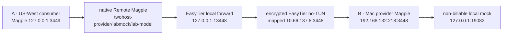

# Fresh BSC/Base deposits through two-host EasyTier and Remote Magpie — 2026-10-30

**VERIFIED — fresh-payment acceptance completed on two independent hosts.** New BSC and Base testnet payments automatically credited the same real Gateway Key and restored native Remote Magpie calls over EasyTier no-TUN. Restart recovery, original EIP-712 attribution, both zero-credit duplicate scans, the read-only SQLite audit and cleanup all passed.

This follow-up is limited to validation. PRs [#8](https://github.com/faithleysath/magpie-oh-my-aihub/pull/8), [#9](https://github.com/faithleysath/magpie-oh-my-aihub/pull/9), and [#10](https://github.com/faithleysath/magpie-oh-my-aihub/pull/10) were merged in that order with merge commits, preserving the stacked ancestry. #9 and #10 were retargeted to `main`, their remaining diffs inspected, and both Linux/macOS checks rerun successfully before merging. The implementation base of this experiment is `8028a81852409e3201d11f44b83811c3ab5d5dd3`.

## Exact environment and evidence identity

| Component | Measured platform/version | Identity |
| --- | --- | --- |
| B, provider | macOS 26.6.2 (25G83), Darwin 25.6.0, arm64 | physical Mac; isolated portable data under `/tmp/phase7-twohost-wallet` |
| Provider Magpie | 0.1.2038, Go 1.26.8 | build metadata: `vcs.revision=8c63c5b7873c6aa7aa797aa17f481d5fa8301876`, `vcs.modified=false`; binary SHA-256 `0640889d004edfc1da0cd12bf8995e134968ea9b8ac4887d295d8989dadd4e15` |
| A, consumer | Debian 12, Linux 6.1.0-54-amd64, x86_64, `us-west-vps` | independent VPS; dedicated temporary container/configuration |
| Consumer Magpie | official no-GUI container, `magpie v0.1.2057` | image `ghcr.io/yetone/magpie@sha256:900711e2867299e6dbc7d9b02112e86d0a00add626f61bacfad83be0da5fbe5e`; extracted binary SHA-256 `1f4fe9fc13a7298898fe5a049ad569ff531a642b5143dd1b9599fd20d06e18a3` |
| EasyTier, both hosts | 2.6.4-8428a89d | source `8428a89d2dabc94c97d370ec607c6ca142473626`; both release zips match `plugin/src/easytier-manifest.ts` |
| Wallet harness | Bun 1.4.3, existing production classes | `Wallet`, `ChainWatcher`, `ChainStore`, `Ledger`, `Provisioner`, `Magpie`; no production module changed |
| Signing/broadcast | Foundry 1.8.6 | `6bad0a66de7c83f7b33695044138f0f5fa4c5990`; encrypted throwaway consumer keystore and password file outside git |
| Model upstream | deterministic local HTTP mock | `127.0.0.1:19082`, test prices 1/2 USD per million tokens; no vendor request |

VERIFIED: provider revision is embedded in the actual executable. UNKNOWN: the consumer executable has no embedded VCS revision and the image has no revision label. The upstream `v0.1.2057` tag resolves to `2c89794acb333b8b9875927a204e0de79ab44d2c`, but that is a release-source reference, not independent proof of the binary's source revision. The immutable image and extracted executable hashes are the consumer's measured identity.

## Actual sockets and restrictions

VERIFIED: both EasyTier route tables report `DIRECT`, `path_len=1`, roughly 211–253 ms. The Mac initiates TCP to the consumer's temporary EasyTier listener on `11078`. SSH only provisions files and triggers commands on A; AI traffic uses the native Remote Magpie and EasyTier forward. The Mac already had an egress proxy/TUN address (`198.18.0.1`); this experiment did not create or change system TUN interfaces, routes, or proxy settings. `no_tun=true` refers to both lab EasyTier instances.

Both nodes have Inbound default Drop with no allow rules. B's Forward chain defaults Drop and allows only TCP 3448. A's Forward chain defaults Drop without rules. RPC portals are explicitly pinned with `-r 127.0.0.1:15897` / `:15898`; the consumer gateway and all local forwards bind loopback. B binds only its own LAN address and sets `MAGPIE_ALLOW_IPS` to that same address. `magpie web` is never started.

REPRODUCED from A on the actual ingress:

| Probe | Observation |
| --- | --- |
| mapped `/v1/models`, no key | 401 |
| mapped `/v1/models`, wrong key | 401 |
| mapped `/v1/models`, original valid key | model discovered by native Remote Magpie |
| provider virtual IP:3448 | timeout, ACL drop |
| mapped address:22 | timeout, ACL drop |
| consumer virtual IP:3449, from B | timeout, ACL drop |
| mapped `/api/caller-keys`, valid key | 404 |
| mapped `/api/settings`, valid key | 404 |
| mapped `/`, valid key | 200 public capability JSON, `window:false`; no admin UI |

## Fresh payments and automatic accounting

The pre-existing mock contracts and funded disposable testnet wallet were reused. **The invoices, EIP-712 signatures, mints, and payment transactions in this run are new.** During setup, only the old deployment addresses were read from earlier lab metadata; no old invoice or payment was inserted into the new store. The retained harness now takes those same public deployment addresses from `assets.json`, so reproduction does not require the previous private SQLite files. Each invoice was created, persisted, and signed before either payment. Full original typed data, digest, public signature, payer, timestamps and matching event are retained in the evidence. The provider database verifies each signature locally.

Both consumers' payment transactions originate from the disposable consumer wallet. The two new mint logs, from zero address to the consumer, are observed but remain `unclaimed`; they do not increase the Gateway Key cap. Exactly the two signed consumer-to-provider transfers are eligible to credit.

| Chain | New payment | Receipt block | Raw amount | Condition |
| --- | --- | --- | --- | --- |
| BSC testnet, 97 | [`0xe5edb6d3510056b47bde2d14344c8c36f65d38ccd0a9c147951b7a6c04309820`](https://testnet.bscscan.com/tx/0xe5edb6d3510056b47bde2d14344c8c36f65d38ccd0a9c147951b7a6c04309820) | 139746922 | 1000000, 6 decimals | existing 15-confirmation substitute policy |
| Base Sepolia, 84532 | [`0x1fca28a8d6ae900b6229ff1c232ff27ff648b867bad471c19d52cc75531609c0`](https://sepolia.basescan.org/tx/0x1fca28a8d6ae900b6229ff1c232ff27ff648b867bad471c19d52cc75531609c0) | 52075327 | 1000000000000000000, 18 decimals | real `finalized` tag must reach the payment block |

New BSC mint: `0xeb2a98ad1f6b8919486ae8b3b573ed25ea16b15f4331a9461a9e8ed7fed9d8fa`. New Base mint: `0x66fb84342fd1a48b0893b5e26cc7bb4d97f3c0dc0e606ebf38cc4a62eb3b8b7a`. Four testnet writes total; no deployment or native-coin funding transfer in this run.

`Wallet.start()` starts the two production timers before broadcasting. The BSC payment was automatically observed at 05:08:48Z, finalized at 05:08:58Z, and credited at 05:08:59Z. No manual scan, ledger injection, or hand-written cap increase caused that credit. Base was automatically observed at 05:08:59Z and entered `confirming`, roughly 6028 blocks short of its finalized tag. Its finality condition was reached at **05:30:45.698Z**, and automatic credit completed at **05:30:46.616Z**; the remote call resumed at **05:30:48Z**. Waiting did not resend the payment or replace the invoice.

### Observed native HTTP sequence, from A

| UTC | Consumer request | Native result |
| --- | --- | --- |
| 05:08:34 | spend explicitly simulated $0.0001 opening credit (100 input tokens) | 200 |
| 05:08:35 | before either new payment | 429 |
| 05:09:11 | after automatic BSC credit, spend $1 (1M input tokens) | 200 |
| 05:09:12 | BSC credit exhausted; Base still unfinalized | 429 |
| 05:10:11 | after restarting both Magpies and the wallet watcher | 429 |
| 05:30:48 | after automatic Base credit, same Remote Magpie and key | 200 |

All calls go to A's `127.0.0.1:3449/v1/chat/completions`, naming the same native Remote Magpie model. No forwarding header is added by the lab client. Provider Magpie performs key authentication, native reservation, accounting and refusal. The consumer surfaces its provider's rate-limit error as `Remote magpie: ...`, with HTTP 429 and `Retry-After`.

### Restart and idempotence

VERIFIED: before restart, BSC is `credited` and Base is `confirming`. The watcher process, provider Magpie, and consumer Magpie are stopped and restarted. BSC's spent state survives; the original Base invoice, recovered signer, event and scan cursor are read from SQLite on the new watcher process. The same consumer provider record is reused. This is controlled process restart, not power-loss or mid-transaction crash simulation.

VERIFIED: after both automatic credits, the watcher was stopped and each chain's scan cursor deliberately rewound to before this run's first event. Each rescan observed the same two logs, added **zero** events and **zero** credits, and preserved the cap. A fresh read-only SQLite connection confirmed three applied deposits (the explicitly simulated opening credit plus the two new on-chain payments), three priced consumption rows, and no uncertain charges. Both original signatures were independently reverified against their unchanged documents. The Gateway Key ID, secret and native window are unchanged.

| Final quantity | Observed |
| --- | --- |
| Opening simulated credit | $0.0001 test USD |
| BSC credit / native cap after credit | $1 / $1.0001 |
| Base credit / native cap after credit | $1 / $2.0001 |
| Total applied deposits | $2.0001 |
| Priced consumption | $1.0013 |
| Ledger balance | $0.9988 |
| Duplicate credits, BSC / Base | 0 / 0 |
| Mint logs credited | 0 (both stay `unclaimed`) |

VERIFIED cleanup at 05:33:36Z: the lab Key was revoked and its original secret then received **401 through the real overlay**. The provider/mock and both lab EasyTier processes were stopped, the consumer container and its temporary credential/config were removed, all listed lab ports were free, and the consumer's UFW rules matched the saved baseline. Only the owned temporary resources were stopped.

VERIFIED local validation: **392 tests pass, 0 fail, 1438 assertions, 25 files**; strict typecheck, boot-check and secret-scan pass. The new docs harness is included by the existing TypeScript/PR workflow path rule. Python helper syntax also passes. CI typechecks the harness; it does not execute a funded wallet experiment.

## Source checks

The source checkouts were clean at the exact pinned commits; no upstream changes were made.

- Magpie [`local()` and `proxied()`](https://github.com/yetone/magpie/blob/8c63c5b7873c6aa7aa797aa17f481d5fa8301876/internal/gateway/lan.go#L634): loopback and forwarding-header rules. The real mapped socket avoids the loopback bypass.
- Magpie [`budget.go`](https://github.com/yetone/magpie/blob/8c63c5b7873c6aa7aa797aa17f481d5fa8301876/internal/budget/budget.go#L387): native reservations, and the usage/cap behavior already measured in earlier labs.
- EasyTier [`connect_to_nat_dst()`](https://github.com/EasyTier/EasyTier/blob/8428a89d2dabc94c97d370ec607c6ca142473626/easytier/src/gateway/tcp_proxy.rs#L742): virtual-IP destinations are rewritten to loopback; other destinations retain the real address.
- EasyTier [`build_default_actions()`](https://github.com/EasyTier/EasyTier/blob/8428a89d2dabc94c97d370ec607c6ca142473626/easytier/src/common/acl_processor.rs#L281): a missing Inbound/Forward chain defaults to Allow, so both are explicit Drop.
- Local [`Wallet.start()`](../../plugin/src/wallet.ts), [`ChainWatcher`](../../plugin/src/watcher.ts), [`Provisioner.applyChainDeposit()`](../../plugin/src/provisioner.ts) and [`Ledger`](../../plugin/src/ledger.ts) are unchanged from the merged PRs.

## Reproduce and inspect

See [the lab instructions](lab/phase7/TWOHOST.md). `fresh-twohost.ts` separates provisioning, signing, transaction broadcasts, automatic watching, snapshots, duplicate scans and revocation. Broadcast markers are persisted before invoking `cast`; any previous attempt, including an unknown result, blocks blind resending. Keystore secrets stay outside argv, reports and git. The live wallet holds no private key: the disposable lab signing tool reads a separate encrypted keystore.

`twohost-audit.ts` only reopens local evidence and SQLite; it sends no RPC or chain write. The evidence directory contains the sanitized events, consumer HTTP responses, original signatures, raw mint/payment receipts, pending state before restart, final native snapshot, database audit, version metadata, network probes and cleanup verification.

The public [evidence directory](phase7-twohost/) contains:

| Evidence | Files |
| --- | --- |
| Original intent documents and public signatures | `signed-intent-97.json`, `signed-intent-84532.json` |
| Broadcast hashes and receipts | `mint-*.json`, `payment-*.json`, `raw-rpc-before-finality.json`, `raw-rpc.json` |
| Automatic credit and native consumer calls | `events.jsonl`, `acceptance-calls.jsonl` |
| Restart and final ledger | `before-restart-watch.json`, `restart.json`, `snapshot.json`, `audit.json` |
| Real ingress, ACL and admin isolation | `network-evidence.json`, `provider-sockets.txt`, `auth-responses.json`, `admin-probes.json` |
| Installed identities and checks | `versions.json`, both `*-build-info.txt`, `ci-summary.txt` |
| Revocation and teardown | `cleanup.json` |
| Evidence integrity | `manifest.json` (SHA-256 of each exported file) |

The exporter checks every allowlisted file for the exact disposable private keys, Gateway Key, keystore password, and overlay secret before writing it. Only trailing whitespace is normalized in the exported text; no successful response or chain result is synthesized.

## Failures and corrected assumptions

These are recorded as failed attempts, not passes:

1. The first temporary Python setup failed because an unrelated `/tmp/glob.py` shadowed the standard library. Re-running with `python3 -I` resolved the import without changing that unrelated file.
2. Initial keystore-import setup used a non-existent `bin/cast` path, then lacked a controlling terminal for the private-key prompt. It was corrected to the pinned executable and a private PTY; no chain write occurred in those attempts and no private key was printed.
3. A parallel consumer registration attempt found the isolated container not running and returned nonzero. It stopped before changing the actual key. Successful registration, model discovery and every AI request above were then performed by the main experiment process. No failed registration is counted as a successful request.
4. A negative probe incorrectly expected `/` to be 404. It returned public capability JSON with `window:false`. `/api/caller-keys` and `/api/settings` are the admin probes and both return 404; the corrected probe checks the root's actual public shape separately.
5. One harness edit failed strict TypeScript nullability checking for executable discovery. It was corrected before execution of that version; subsequent typecheck passes.
6. After Base credit and successful remote HTTP 200, the supplementary raw-RPC collector timed out on its first attempt (`raw-rpc-first-attempt.txt`). The completion script stopped before audit/revocation. Only the read-only collection was retried; it succeeded, then the independent audit passed. Neither payment nor either duplicate scan was repeated to hide the timeout.

## Scope of the result

This experiment uses two independent hosts, new public testnet payments, original pre-payment signatures, automatic production watchers, real SQLite and real native Magpie gateways. The upstream and token valuation are deliberately synthetic. It does not establish paid vendor execution, long-running availability, hardware-wallet behavior, a new reorg distribution, a real clock-window rollover, or crash atomicity. Mainnet pricing lock and the other architecture blockers are unchanged. **Real funds remain NO-GO.**
