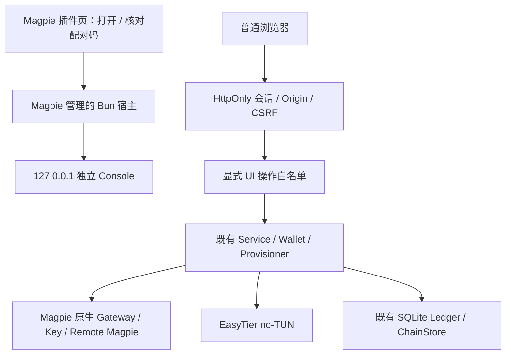

# Phase 9 — 独立浏览器控制台与无 CLI 用户流程验收

**Browser UX：GO（已测 macOS Chromium/WebKit 范围）。Testnet P2P：GO（限定：真实 Magpie/EasyTier、模拟模型、本地模拟链集成及独立引用的 PR11 公链证据）。Real-money Production：NO-GO。**

普通流程已经改为：Magpie 插件管理界面安装 → 内置入口打开浏览器或明确配对 → 网络设置 → 模型共享/发现 → TOFU 核对 → 人工审批 → 私密授权文件 → 原生 Remote Magpie → 外部签名与测试网入账 → 私有账务。验收代理没有用 operator CLI、手工管理 HTTP、内部 JSON/SQLite 编辑填补页面功能。高级故障恢复保留在 [ADVANCED-CLI](../ADVANCED-CLI.md)。

## 1. 前置条件、版本与源码身份

| 项目 | 证据与范围 |
| --- | --- |
| PR12 | 原 HEAD `59a02ce` 完成独立审查；三项启动/选项缺陷修复至 `1897e243a2fda9ffbcc3fd7e5e2c067038c2ebb9`，Linux/macOS CI 通过。用户明确授权后合并为 `98056d7b17cf6292f9f7db6028d41a1125ddb2bc`，再创建 `feature/local-web-console` |
| 最终生产源码 | `cf9833e8ca931fe48b244a0cc24c54441a2c258e`；其后提交仅收束验收脚本/报告/证据。三个节点**实际启用安装包**各51个生产文件与仓库完全一致，153/153匹配，0不符 |
| 平台 | macOS26.6.2 (25G83), Darwin25.6.0, arm64 |
| Magpie | 真实0.1.2171，源码 `244d80e23f91ab4e2b37b4e045d61fda5f7bca50`；可执行文件 SHA256 `303de4c853ba74f47404cc7912b371385cbfc1cd68abeeeb1b555d3347db72c6` |
| Magpie 宿主 Bun | Magpie 管理的1.4.4，SHA256 `0a2237cdcfa0d16ef501d9acca9f0026309ef348bea7393a64e8d1e3609565cc`；隔离实例 PATH 仅系统目录，没有独立 Bun |
| EasyTier | 2.6.4，`8428a89d2dabc94c97d370ec607c6ca142473626`，真实 no-TUN、ACL、子网映射与转发；二进制哈希在 manifest |
| 浏览器 | ego Chromium156；Playwright1.64.1 驱动 WebKit27.2。原生 WKWebView 不等同于此 WebKit 测量 |
| 开发/CI | Bun1.4.3，严格 TypeScript；插件0.5.0，无前端运行时框架或 Electron |
| 既有财务基线 | 0.1.2038 的价格/限额测量继续有效；0.1.2171 本轮证明指定模型/额度路径，未重新测量其全部价格重算、并发超支或真实厂商行为 |

**VERIFIED**：[实际安装源码 manifest](lab/phase9/evidence/final-installed-source.json)。其中初始 `repoHead` 是实验准备基线，`sourceReference.repoHead` 与 `actualInstalledSource` 才是最终逐文件比较；闲置 fixture 副本另行标记，未冒充 GitHub 安装包。

## 2. 参考项目与架构决定

已按真实源码研究两个参考仓库，包含指定文件、许可证、准确 SHA、行号、测试结果及失败：
[参考研究](phase9-reference-research.md)。Our Free Model 固定 `e1a9b25ddb910acaf97df09ed23e08a08b93fcc5`；Busy Magpie 固定 `5b15937308569666a89ab317f2adac1ab07467f1`。

**VERIFIED**：OFM 的浏览器入口属于真实 Provider OAuth，普通控制插件不能直接复用。Magpie 普通插件桥没有 external-open 方法；page.service 转发移除 Cookie/Set-Cookie 并保留 sandbox。本项目没有伪造 Provider。借鉴一次性票据、宿主进程归属、错误/旧状态区分与重连方式，独立实现；未复制第三方实现或品牌资产。Busy 的 Electron 安装器和 OFM 的模型引擎/Cloudflare 通道不引入。

Console 与原来的 Service 同宿主、同单一所有者；没有新 AI 路由、预算代理、中心化服务或余额数据库。锁用 SQLite 独占事务作进程协调，不存账务。普通业务表单直接调用 Service；只有打开/配对批准使用官方 options 桥，因此这些动作会重启**共享宿主**，已有浏览器会话随之失效。

## 3. 无终端安装、打开与会话

**REPRODUCED**：消费者和第二提供者在真实 Magpie Discover 页面清空搜索，使用底部安装框输入 GitHub 分支地址，成功安装；之后通过 Installed → Check for updates → Update 更新。无需源码目录、数据目录、PATH 或独立 Bun。[安装/更新截图](phase9-browser/github-install-update.png)。正式合并后的普通地址为 `github:faithleysath/magpie-oh-my-aihub`；验收分支地址用于取得尚未合并的实现。

主入口为内置 Tab 的“打开控制台”：官方选项保存非秘密请求，宿主以固定 argv 打开系统浏览器，短期256-bit票据兑换会话并立即移除地址片段。实际默认 Chrome 显示已登录欢迎页：[截图](phase9-browser/native-default-chrome-welcome.png)。页面仍使用 Magpie 原有 CSP。

其他浏览器打开普通回环地址后只有匿名页面。用户点击配对，在 Magpie 核对完整八位码并明确批准，持有256-bit临时秘密的浏览器才可兑换新实例会话。预授权记录仅存哈希，2分钟过期，最多8条，消费先持久化；旧会话不会跨重启复活。当前来源不是“任何访问 localhost 的网页都是管理员”。

**REPRODUCED 浏览器差异**：HTTP127.0.0.1 上 Chromium 接受 Secure Cookie，WebKit 拒绝，兑换后下一请求401。最终只在专用回环 HTTP 上使用 HttpOnly、SameSite=Strict、`Path=/ui/`，不设置 Secure；精确 Host/Origin/CSRF 独立实施。[原始 Cookie 结果](phase9-browser/webkit-cookie.json)，[阶段1报告](phase9-stage1.md)。

会话绝对8小时、空闲30分钟；被动轮询不延长人为活动期限；主动退出、宿主退出和重启均撤销权限。客户端不把 Token、Gateway Key、网络密码、签名或私钥写入 localStorage/sessionStorage/IndexedDB。密码管理器属于浏览器外部行为，文档没有声称插件能阻止它保存输入。

## 4. 页面与真实业务对应

| 页面 | 实际功能与业务入口 |
| --- | --- |
| 总览 | 本地缓存状态、证据时间、EasyTier/节点/共享/连接/安全检查；主动检查调用 Service.checks，不把历史记录标为实时证明 |
| 发现模型 | 搜索伙伴/模型、在线与目录状态、完整指纹、TOFU、基础/缓存/一小时缓存/阶梯价、能力、报价与价格版本；显式信任、申请导出、授权连接 |
| 我的共享 | 原生有价模型白名单、公开名称、签名 Catalog 发布/暂停、本人目录身份、申请导入/拒绝/人工审批、正数额度、授权检查/收窄/撤销/重发、显式私密 Key 交付 |
| 我的连接 | 授权文件预览及确认、原生 Remote Magpie、多提供者、模型列表/鉴权与额度检查、单独更新 Key/移除；cap0显示无限制/不安全，缺失显示未知 |
| 测试网钱包 | 注册表驱动的97/84532平权配置、RPC/资产/收款、观察器控制、精确申请预览/创建/恢复/取消、EIP-712文件与可选注入钱包签名、签名归属验证、准确转账指引、最终性/入账/Key证据时间线、异常审计 |
| 用量与账单 | 按消费者隔离的充值/消费/余额/超支/计费窗口/价格版本、逐条不可变消费记录与50条分页、缺口审计、原生额度读回、未签名账单导入/导出 |
| 网络与设置 | 幂等首次向导、两个独立能力、网络邀请与安全设置、监听和高级端口；保留原有 Provider/模型，空密码不回显或覆盖 |

明暗与窄屏：[WebKit dark](phase9-browser/webkit-stage1-dark.png)、[mobile](phase9-browser/webkit-stage1-mobile.png)。最终逐条消费记录：[截图](phase9-browser/final-consumption-history.png)。

## 5. UI API 权限清单

固定传输为 `/ui/session`、`/ui/pairing`、`/ui/pairing/exchange`、`/ui/api/state`、`/ui/logout` 和 `/ui/api/action/<name>`；匿名票据/配对接口不返回私人状态。原脚本 API 保留独立 Bearer 凭据，Console 不读取或向 JS 交付该 Token。

所有操作需要当前会话；写入另需同源 JSON、CSRF、操作 UUID，以下为唯一允许的业务名称，不能透传任意 Host API：

| 类别 | 操作 |
| --- | --- |
| 网络/检测 | configure, checks, share-toggle, consume-toggle |
| 模型/目录 | share-candidates, share-models, catalog-publish, catalog-discover, catalog-refresh, catalog-settings |
| 信任/申请 | trust-peer, connection-request, request-import, request-approve, request-reject |
| 授权/连接 | key-reveal, connection-preview, connection-import, catalog-connect, provider-models, provider-check, provider-update-key, provider-remove |
| 消费者 | consumer-check, consumer-models, consumer-reissue, consumer-revoke |
| 钱包设置 | wallet-refresh, wallet-network, wallet-start, wallet-stop, wallet-asset-register, wallet-asset-toggle, wallet-receiving |
| 充值/文件 | wallet-intent-preview, wallet-intent-create, wallet-intent-document, wallet-signature-import, wallet-intent-cancel, deposit-document-preview, deposit-signature-document |
| 证据/账务 | wallet-scan, wallet-anomaly-resolve, wallet-statement, wallet-statement-preview, accounting-refresh, accounting-history, usage-gap-resolve |

Key 查看属于敏感一次性响应，同 UUID 重放/并发不能再次得到 Key，普通幂等缓存不留密钥响应。充值 UUID 使用持久化预留/结果，未知结果不盲重试。钱包记账只经原 Watcher/Provisioner 幂等链路。价格改变不重算已记账费用；本轮没有放松暂停、ACL、白名单或限额保护。

## 6. 无 CLI 用户旅程与浏览器结果

**REPRODUCED**：[分享/连接报告](phase9-stage2.md) 和 [钱包报告](phase9-wallet.md) 记录完整提供者/消费者角色。三份新隔离配置分别运行真实 Magpie、EasyTier 和各自插件副本/安装包；上游仅为本地 mock 模型。文件通过正常浏览器下载和选择交付，没有手工构造 JSON。

- Chromium：真实安装/打开/配对/配置、原生模型发布、发现、完整指纹核对、申请、人工审批、私密 Key 文件、Remote Magpie、原生模型200→429→经生产账本授信→200。
- WebKit：入口与配置6项、第二提供者完整分享5项、独立故障/XSS/恢复9项、钱包与授信9项、最终安装/消费记录/权限拒绝6项，共**35个记录检查点**。这些不是35个独立金融安全证明，而是对应 JSON 中的 UI 步骤/场景。
- 恶意 Catalog 名称按字面显示：0注入图像、0脚本执行、0相关图片请求。第二提供者暂停后，第一提供者仍在 Magpie 原生“测试模型”成功；恢复第二提供者后模型恢复。[独立代理验收](phase9-browser/webkit-resilience.md)。
- 最终构建经真实 UI 更新和授权，消费记录展开显示原始费用、价格版本、窗口和 token；缺 CSRF 403、未授权内部路径404、JS不可读会话Cookie、浏览器存储为空，退出刷新需重新授权。[最终 UI 结果](phase9-browser/final-installed-ui.json)。首次最终脚本等待折叠内容可见而失败，随后改为先展开消费记录再断言；[失败记录](phase9-browser/final-installed-ui-failure.json)保留，未修改业务结果。

原生“Test models”使用 Magpie 的 Provider.TestModels 访问所配置 Remote Magpie，不经过插件推理代理。本轮不把它写成额外完成了外部客户端穿过消费者 Gateway 的全新 HTTP 旅程；此前跨机器证据独立保留。

## 7. 钱包证据边界

本轮两条 RPC 都是清楚标注的**本地模拟链**，复用97/84532标识；外部合成钱包无资金，独立进程临时密钥不进入产品。生产钱包、验签、Watcher、ChainStore、Ledger、Provisioner 与真实原生 Key 均未替换。

BSC 的0/15阶段不授信，15确认后才记账；Base增加20个 head 区块仍不授信，推进 finalized 后才入账。Key未读回时保持“入账结果尚未证实”。两次 `$1` 事件后，重复事件/扫描仍累计 `$2.0001`（含初始 `$0.0001`）。WebKit又完成新 `$0.5` 请求，确认前金额不变，最终达到 `$2.5001`，重放不再增加：[9项完整结果](phase9-browser/webkit-wallet.json)。

[模拟夹具快照](lab/phase9/evidence/wallet-fixture-before-webkit.json) 在 WebKit 第三事件前采集，不能冒充第三事件的最终快照；第三事件的原生 cap/账本前后值由 WebKit UI 结果记录。BSC/Base真实公链付款只引用已合并 [PR11证据](2026-10-30-fresh-twohost-wallet.md)，本阶段没有新公链交易或真实资金。

## 8. 安全复审与回归

详见 [安全报告](phase9-security.md)。独立子代理和主代理审查复现并修复了生命周期锁回收、异步窗口关闭、已有连接绕过 TOFU、授权文件/实际 Key 模型范围不符、金额超限留下预留、账单上限不一致及旧 RPC 证据缓存等问题；都有明确回归，不是只加页面。

最终本地检查：**745 pass、0 fail、5930 assertions、52个 Bun 测试文件**；严格 TypeScript、boot-check、secret-scan、diff-check通过。另有**10个 Python隔离/来源/清理 harness测试通过**。覆盖既有 ACL、TOFU、Gateway Key、Ledger、Pricing、Usage Gap、Wallet、Reorg、Deposit Idempotency、Remote Magpie、宿主生命周期和旧页面 CSP 规则。未新增普通 CLI 向导或 PATH 安装器。

GitHub Linux/macOS 在候选 `39c297a` 已双绿：[run41052896672](https://github.com/faithleysath/magpie-oh-my-aihub/actions/runs/41052896672)。最终 PR HEAD 的双平台结果以该 PR 的实时检查记录为准，不把旧候选检查冒充最终提交检查。发布交付回复前会再次核对其实际 HEAD 与两项结果。

本次实验22项实际私密值与仓库全部文本文件比较，无命中；包括本机管理令牌、网络秘密、Key、临时启动能力和新签名文件内容。[扫描结果](phase9-browser/private-value-scan.json)。截图仅保留公开身份和合成测试账务；实际 Key 查看时不拍照，不提交私密下载文件。

## 9. 实验清理

**REPRODUCED**：三个节点各4个实验进程，共12个，全部停止；27个节点端口全部释放，剩余实验节点 PID 为0。独立低高度/高高度 RPC夹具与 Cookie探测服务均停止，WebKit上下文关闭，ego任务空间21结束。临时 Magpie配置、Gateway Keys、网络秘密、签名与授权下载均随实验根目录删除。

证据：[进程/端口检查](lab/phase9/evidence/final-cleanup.json)、[删除后结果](lab/phase9/evidence/final-cleanup-deleted.json)、[简要清理记录](phase9-cleanup.json)。清理只针对本次所有者验证的实验进程与目录，用户真实 Magpie配置未被修改。保留公开源码研究副本和脱敏报告，不保留本次可用实验凭据。

## 10. 明确未验证及产品限制

- **UNKNOWN**：真实 MetaMask/Rabby 等扩展的完整交互、原生 WKWebView、Linux/Windows桌面打开、SSH端到端访问、首次桌面启用自动打开、完整10分钟忙宿主交接。它们有设计/部分测试，不从浏览器或 CI 推断全部通过。
- 浏览器账单交接上限48KiB；更大历史账单没有分页导出，需高级维护。消费记录本身支持50条一页的私有分页。
- 真崩溃留下的未知创建预留保持阻止，普通 UI 不自动清除；需要高级人工恢复。这是故障恢复限制，不是正常申请路径的 CLI 替代。
- 无真实厂商费用、无主网资金、无新公链付款；原生价格锁定、超支、日志缺口、RPC信任等真实资金阻塞仍存在。
- 本次是隔离自动化验收代理的“无 CLI 用户”流程，没有宣称开展真实人类可用性研究。

在上述明确测量范围内：**Browser UX GO；Testnet P2P GO（limited）；Real-money Production NO-GO。**
